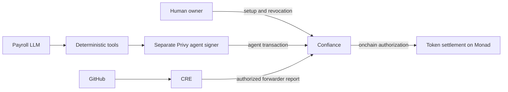

# Confiance

Confiance is an onchain execution firewall that lets AI agents act autonomously without giving them unrestricted control of a wallet.

**Give an AI agent a job without giving it your wallet.**

An unrestricted agent key can drain a treasury. Confiance lets a human establish
bounded authority, an agent sign its own requests, and a contract enforce the
budget, asset, recipient, expiry, milestone and revocation rules before settlement.



## Current status

Public preview: **https://confiance-eta.vercel.app**.
Owner console for this preview: **http://localhost:3050** (existing localhost passkey).
The Render-hosted Gemini worker paid another real 30 CTT after PR #2 was merged and
the task-discovery CRE workflow verified it. MongoDB stores tasks, monitoring,
execution intents and receipts. Task setup and Start/Pause monitoring work in the
app without editing environment variables. See [HOSTING.md](docs/HOSTING.md).

The core autonomous payment flow is proven on Monad testnet: the human approved
its session, CRE verified the merged GitHub PR, and Vertex Gemini requested a
30 CTT payment through a separate Privy signer without an owner payment signature.
Confiance recorded 30 spent of a 50-token budget and rejected a 500-token attempt.
ERC-8004 identity 2210 is minted and Envio indexing is live.
The same Privy key also failed after owner revocation, and reused nonce execution
reverted. The complete compliance requirement still needs Cleanverse
enrollment/issuance and compliant-transfer proof.
Verified addresses and receipts are in [DEPLOYMENTS.md](docs/DEPLOYMENTS.md), with
current blockers in [LIVE_PROGRESS.md](docs/LIVE_PROGRESS.md).

Implemented:

- Foundry contract with immutable owner, separate registered agent signers,
  cumulative session budget, expiry, revocation, recipient/asset restrictions,
  persistent nonces, policy generations, and safe ERC-20 execution.
- CRE-compatible receiver, disabled until the owner pins a contract forwarder,
  workflow ID and workflow owner. Domain-bound condition reports and ERC165 support.
- 59 Solidity tests, including 512 fuzz runs and adversarial token tests.
- Local signed-transaction smoke test: 30 CTT executes; 500 CTT, replay and
  same-key payment after revocation produce real reverted local receipts.
- TypeScript payroll runtime with six fixed tools and a server-side Privy
  adapter. Live Vertex reasoning, Privy signing and payment receipts are verified.
- Monad-only deployment script, receipt/build verification and secret-safe preflight.
- Next.js dashboard with Mera owner onboarding, deployment, funding, session creation/update and revocation.
- Authenticated server orchestration, Privy wallet provisioning, autonomous polling, durable execution lock and receipt-backed task deduplication.
- ERC-8004 agent registration and wallet-binding verification; the Monad registry has deployed code and reports version 2.0.0.
- CRE GitHub workflow compiled to WASM, requiring consensus merge evidence and authenticated reporting.
- Envio schema, typed handlers, deployment-derived configuration, GraphQL history and independently checked reverted receipts.

The local test token is **CTT, not USD, a stablecoin, or a Cleanverse A-Token**.
Only test fixtures use mock compliance or reporting. No final UI consumes fixtures.
Real owner policy approval, provider signing, registry minting, CRE delivery and
autonomous payment are now verified. The official Cleanverse validator adapter is
tested but undeployed; Confiance enrollment and compliant settlement remain unproven.

## Run locally

Requires Node 24+, npm, and Foundry with Solidity 0.8.28 available. CRE compilation also uses the pinned Bun runtime.

```sh
npm ci
npm run contracts:build
npm run contracts:test
npm run abi
npm run typecheck
npm run indexer:typecheck
npm test
npm run test:local
npm run lint
npm run build
npx playwright install chromium
npm run test:web
npm run cre:setup
npm run cre:build
```

The local smoke test starts and stops its own Anvil on port 18545. Fresh signer
keys stay in process memory; the proof file contains public evidence only.
`proofs/local-smoke.json` is explicitly local and cannot be verified on a Monad explorer.

Start the web application with `npm run dev`, then open **http://localhost:3000**.
The public landing page has four navigation items and detailed product guidance.
Choose **Open app** for `/app/overview`; the sidebar separates account, agent, activity and settings. Without configuration the
app shows setup requirements and empty live values. It does
not simulate a session, payment, wallet or balance. `npm run build` creates the
Next.js production build. Run `npm run start --workspace @confiance/web` to serve it.

## Configure live execution

Copy `.env.example` to `.env`, then follow [SETUP.md](docs/SETUP.md).
Never paste wallet private keys into chat or commit secrets. The deployment
script accepts an encrypted Foundry keystore; the agent signer is accessed through Privy.

```sh
npm run preflight
npm run agent:wallet
npm run agent:run
# Or keep the agent observing the task and retrying autonomously:
npm run agent:watch
```

`agent:run` calls an actual configured tool-calling LLM. It has no fallback model,
fake responses or successful-payment mode. It refuses a mismatched onchain task
condition and submits only the configured payroll payment. A receipt with the
expected `PaymentExecuted` event and matching transaction sender/calldata is
required before a tool reports execution.

## Integrations and limitations

| Integration   | Status                                                                                                              |
| ------------- | ------------------------------------------------------------------------------------------------------------------- |
| Monad         | Real account deployment, two autonomous payments, limit/replay/revocation receipts verified                         |
| Privy         | Real separate agent wallet signs payments; SDK 0.35.0                                                               |
| Mera          | Existing localhost owner signs setup, policy and revocation; hosted domain owner intentionally deferred             |
| ERC-8004      | Real agent identity 2210 minted and wallet binding verified                                                         |
| Chainlink CRE | Real PR #1 and task-discovered PR #2 reports verified onchain                                                       |
| Cleanverse    | Official validator adapter tested; registration HTTP 403, enrollment/issuance and compliant transfer remain blocked |
| Envio         | Hosted HyperSync indexer verified against both actual 30 CTT payment events                                         |

Privy gives the agent a signer. **Confiance gives that signer bounded authority.**
Mera belongs to the human owner and will not supply the agent key. Chainlink
reporting is restricted to the owner-approved deployed workflow/forwarder.

An EVM revert removes all logs, including rejection events. Successful execution
and policy changes can be indexed; rejected attempts require separately labeled
transaction receipts and diagnostic simulations. There is no fabricated
`PaymentRejected` timeline.

Published Privy, CRE and Envio declaration defects are repaired by version-checked postinstall scripts. These repairs change no executable code and preserve strict `skipLibCheck: false` checking. Compatible Envio transitive dependency overrides remove the reported advisories. Review these temporary repairs when upgrading SDKs.
See [INTEGRATIONS.md](docs/INTEGRATIONS.md).

## Documentation

- [Architecture](docs/ARCHITECTURE.md)
- [Security model](docs/SECURITY.md)
- [Integration evidence and blockers](docs/INTEGRATIONS.md)
- [Demo procedure and proof requirements](docs/DEMO.md)
- [Deployment status](docs/DEPLOYMENTS.md)
- [Validation results](docs/VALIDATION.md)
- [Inspection and implementation plan](docs/IMPLEMENTATION_PLAN.md)
