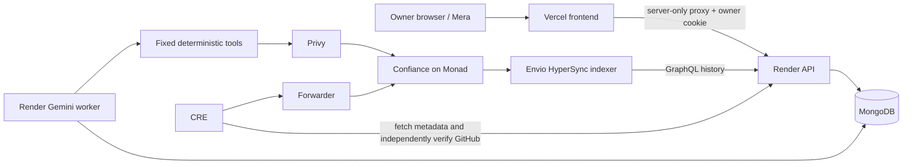

# Architecture

## Authority boundary

The owner is immutable for this MVP. Only the owner can register an agent,
create a session, edit policy, revoke a session or configure a reporter.
Agents call `executePayment` from their own EVM signer; there is no relayer
signature path or arbitrary calldata execution. The caller is the agent identity
used for validation. An owner cannot execute an agent session as its substitute.

```text
Human → Mera/passkey → Owner EOA → Confiance policy setup
Payroll LLM → fixed tools → Privy Agent EOA → executePayment
Confiance checks → ERC-20 transfer → approved recipient
GitHub → CRE workflow → signed report → production forwarder → onReport
Confiance events → Envio → read-side history
```

The owner, separate agent signer, autonomous payment, authorized CRE reports and
Envio ingestion have real Monad testnet evidence. Cleanverse settlement remains
blocked. See [DEPLOYMENTS.md](DEPLOYMENTS.md) for receipts and
[LIVE_PROGRESS.md](LIVE_PROGRESS.md) for the current deployment boundaries.

## Session semantics

`spendingLimit` means **maximum total session spending**, in the allowed token's
smallest units. On success, `spent` increases by `amount`. On rejection, all state
changes revert. Updating policy keeps spent and nonce. Changing the token requires
an explicit new session, so amounts from different assets are never mixed.

Every session and policy edit increments `generation`. Requests prepared under
an older generation revert. A lifetime per-agent `nonce` increments only on
successful settlement and never resets during revocation or renewal. There is
also the ordinary chain-level transaction nonce.

A new session after revocation/expiry explicitly grants a new total budget.
An active unexpired session cannot be overwritten to reset spent. Editing a
revoked policy cannot reactivate it; the owner must create a new session.

The MVP always pins one recipient, preventing an agent from redirecting payroll.
An optional compliance adapter adds asset/recipient eligibility checks. The
interface is Confiance's own abstraction; it is not an invented Cleanverse ABI.
Configured tokens must support exact ERC-20 debit/credit semantics.

## Condition reports

Reporting starts disabled. The owner must pin a deployed forwarder, a nonzero
workflow ID and a workflow owner. `onReport` accepts only that forwarder and
identity. Metadata allows both packed 62-byte identity and the 64-byte production
metadata slice, including report ID. The report carries chain ID, receiver,
condition ID and evidence hash. Cross-chain/cross-account reports and duplicate
condition verification revert. Verification is monotonic for a merged-PR task.

`requiredCondition` is `keccak256(utf8("github:<owner>/<repo>:<prNumber>"))` for
the payroll runtime. GitHub data is informational; only `verifiedConditions`
read from the contract unlocks payment. No HTTP verification endpoint exists.

The receiver trusts a verified Chainlink forwarder to validate DON signatures;
it does not independently authenticate report signatures. A fixture forwarder
in Solidity tests proves receiver validation, not actual CRE reporting.

## Runtime

The LLM gets six tools, all with no caller-supplied arguments. Task addresses,
amount and asset come from owner-authenticated, receipt-bound MongoDB tasks and remain subject to onchain
policy. The signer exposes only a fixed transaction submission helper. No tool
can set policy, transfer ownership or change the milestone. Reads use the real
RPC and GitHub API; failures remain unavailable, never positive defaults.

The runtime validates the chain, checks owner/agent separation, simulates the
contract request, estimates gas, submits through Privy and waits for receipts.
It verifies transaction sender, target, calldata and the exact execution event.
The LLM's prose is never settlement evidence. Pending results are explicitly
unverified. Idempotency is bound to chain/account/agent/generation/nonce.

## History

Policy/session/report/payment events survive successful transactions. Reverted
transactions have no surviving contract events. Envio cannot create onchain
rejection logs; transaction receipt collection must supply labeled failure
history separately. Simulation-only denials also have no transaction hash.

## Owner dashboard and backend access

Mera runs only in the browser. PRF output derives the documented BIP-44 account;
root/key buffers are cleared, and the in-memory signing session ends on sign-out,
unmount or a ten-minute timeout. Only credential metadata is persisted.
Owner transactions deploy/fund/register/configure/revoke; agent payments never
invoke the Mera signer.

The server requires an EIP-191 owner signature over a random, expiring, single-use
challenge bound to origin, owner and chain. It issues an HttpOnly SameSite cookie.
Mutation endpoints reject foreign origins and unauthenticated callers and check
current contract ownership. An operator configures CONFIANCE_OWNER explicitly;
there is no public first-caller ownership claim.

Privy provisioning and ERC-8004 minting persist public IDs in ignored deployment
records. The CLI and web runtime load the same records. Identity registration
uses the Privy agent as ERC-721 owner, so the registry's verified wallet defaults
to that agent. Confiance commits chain, registry and token ID without treating
identity metadata as spending authority.

## Autonomous observation and recovery

`agent:watch` runs a real LLM decision cycle every configured interval (minimum
60 seconds). It waits while GitHub or the onchain condition is incomplete. Once
CRE delivery is confirmed, the agent can request the fixed payment independently.

MongoDB stores task records, monitoring state, durable payment intents, submitted
hashes and completed receipts. A shared lease serializes worker, web runtime and
diagnostics. A payment intent is stored before Privy submission. Its idempotency
key binds chain, account, agent, policy generation and nonce. Recovery resubmits
that same intent or checks its known receipt; it never guesses a new nonce.

A completed task is keyed by account, contractor, asset and GitHub milestone,
including across signer rotation and amount formatting changes. Recovery verifies
sender, target, calldata and execution events before treating it as paid. This is
an operational duplicate-payment guard; the contract independently enforces the
budget and authorization. Database failure stops execution. The hosted backend
does not fall back to ephemeral files. This MVP runs one supervised Render worker.



CRE's public task feed exposes only verification metadata. The workflow checks
that metadata against the account's onchain session and independently verifies the
GitHub merge. The feed cannot mark a condition verified. Owner policy changes
still require the Mera signer; routine payments use only Privy's agent signer.

## Web application routes

The public `/` landing page explains the product and routes its calls to action
into `/app/overview`. The app sidebar separates Overview, Account, Agent, Activity and Settings. Each route renders its own relevant
controls. A persistent app layout retains the in-memory Mera signing session
across client navigation; sign-out, expiry or leaving that layout ends it.

Task configuration and session authorization are distinct. The dashboard reads
both the configured task condition and the session condition from their actual
sources, shows a mismatch explicitly, and asks the owner to save corrected rules.
It never substitutes a verified condition for the one actually authorized by the
session. CRE's recorded onchain verification remains the payment authority even
when the agent's separate GitHub lookup is unavailable; the agent reports lookup
failure honestly and deterministic payment checks still require the exact condition.

The app now has five destinations. Agent includes the separate wallet, identity,
permissions and revocation; test transactions are collapsed under Test permissions.
Overview includes milestone verification. Settings holds CRE and Cleanverse setup.
Legacy policy/security/milestone/connections URLs redirect to these destinations.
The persistent app layout continues to retain the in-memory owner session.

## Workspace access and preview hosting

The workspace state API requires a valid owner session before returning account,
agent, budget, treasury, task or activity details. Signed-out responses contain
bootstrap information only. Signing out or losing the in-memory signing session
locks the UI immediately. Public blockchain events, the registry document, demo
receipts and the limited CRE discovery endpoint remain independently public;
workspace authentication does not make blockchain data confidential.

For the current preview, the human explicitly retained a localhost passkey and
owner console at port 3050. The hosted frontend directs owner actions there;
Render runs observation independently. Passkeys are hostname-scoped and an owner
onboarding ceremony on the Vercel domain has not been claimed. Free Render can
sleep; free Envio development deployments expire after at most 30 days. These
are deployment limits, not part of Confiance's onchain authorization model.
